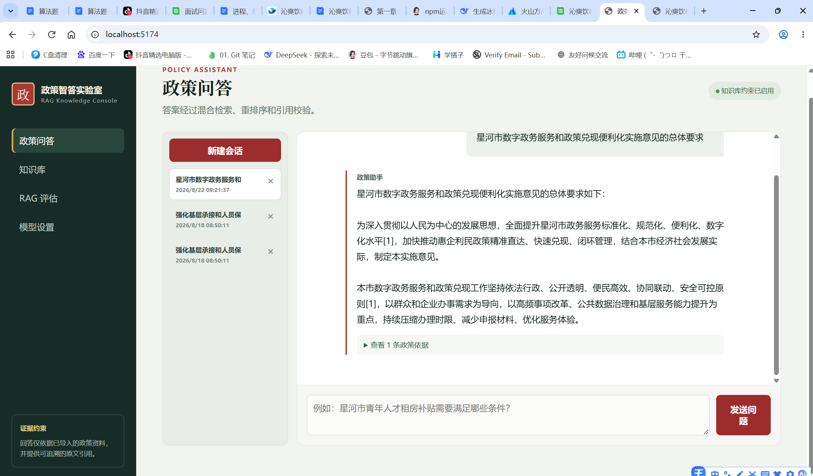
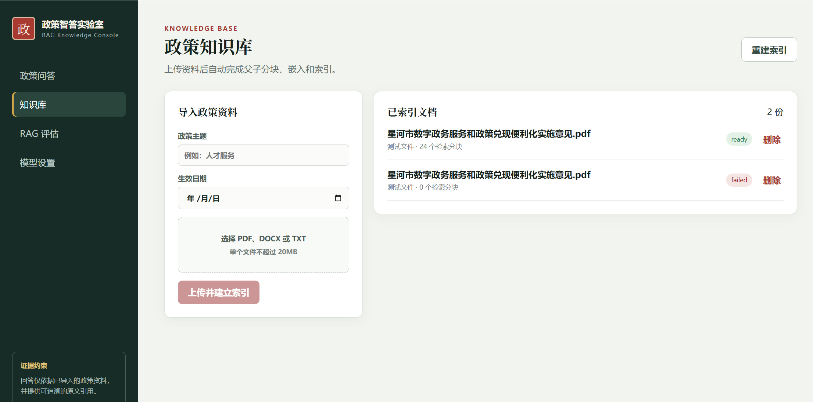
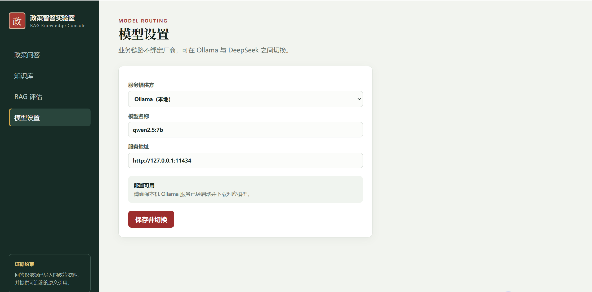
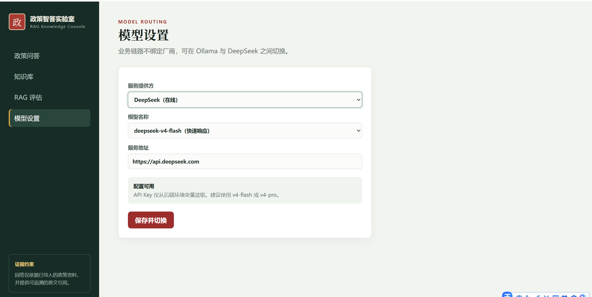
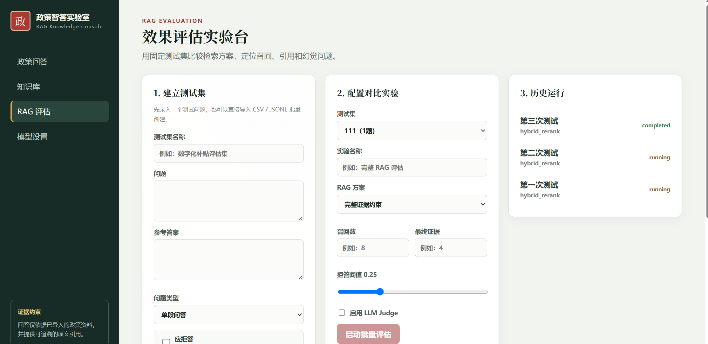

# 政务政策 RAG 问答系统

基于 **FastAPI + LangChain + Vue 3** 的政策知识库问答系统：上传政务政策文件，自动解析分块并建立向量索引，用户以自然语言提问，系统检索证据、给出**带引用角标**的答复，并在证据不足时明确拒答；内置 **RAG 评估模块**，可用指标量化检索与回答质量。

> 项目中的"星河市"等政策文件均为**虚构演示数据**，不涉及任何真实政务信息。



## 目录

- [功能特性](#功能特性)
- [界面预览](#界面预览)
- [技术栈](#技术栈)
- [系统架构](#系统架构)
- [核心实现](#核心实现)
- [快速开始](#快速开始)
- [配置说明](#配置说明)
- [API 一览](#api-一览)
- [数据模型](#数据模型)
- [评估体系](#评估体系)
- [目录结构](#目录结构)
- [已知问题与改进方向](#已知问题与改进方向)

## 功能特性

| 模块 | 能力 |
|---|---|
| 知识库管理 | 上传 PDF / DOCX / TXT，自动解析、按标题层级父子分块、向量化入库，文档列表可查 |
| 政务问答 | 流式（SSE）输出、多轮会话持久化、证据引用角标、无依据时拒答 |
| 混合检索 | 向量召回 + BM25 关键词召回，RRF 融合后 CrossEncoder 重排，双阈值过滤 |
| 模型设置 | Ollama（本地）/ DeepSeek（云端）一键切换，配置落库无需重启 |
| RAG 评估 | 自定义评测数据集，批量运行并输出召回率、MRR、引用准确率、事实一致率等指标 |

## 界面预览

### 政务问答

多轮对话 + 流式回答，回答中带 `[1][2]` 角标，右侧展示命中的政策证据原文。


### 知识库

上传政策文件，查看已入库文档、分块数量与处理状态。



### 模型设置

支持本地 Ollama 与云端 DeepSeek 两种provider，参数保存到数据库，运行时动态生效。





### RAG 评估

创建评测集 → 批量跑评估 → 查看每次运行的指标明细，用于对比不同检索策略（向量 / 混合 / 混合+重排）的效果。



## 技术栈

**后端**：Python 3.10+ · FastAPI 0.115 · SQLAlchemy 2.0 · MySQL（PyMySQL）

**RAG**：LangChain 1.x · langchain-openai / langchain-deepseek / langchain-ollama · Milvus（嵌入式 Lite）· sentence-transformers（bge-reranker）· rank-bm25 · jieba

**文档解析**：pypdf · python-docx

**前端**：Vue 3 · TypeScript · Vite 6 · Pinia · Vue Router · axios

## 系统架构

```
┌────────────────────────────────────────────────────────────┐
│  Vue 3 SPA                                                  │
│  问答 / 知识库 / 模型设置 / RAG 评估                          │
└──────────────────────────┬─────────────────────────────────┘
                           │ axios + SSE
┌──────────────────────────▼─────────────────────────────────┐
│  FastAPI  /api                                              │
│  documents │ chat │ config │ evaluation                     │
└──────────────────────────┬─────────────────────────────────┘
                           │
        ┌──────────────────┼──────────────────┐
        ▼                  ▼                  ▼
  ┌───────────┐     ┌────────────┐     ┌─────────────┐
  │ MySQL     │     │ Milvus     │     │ LLM Provider│
  │ 文档/会话  │     │ 向量库      │     │ Ollama /    │
  │ 评估/设置  │     │ policy_chunks│   │ DeepSeek    │
  └───────────┘     └────────────┘     └─────────────┘
                           ▲
                    ┌──────┴───────┐
                    │ Embedding    │
                    │ + Reranker   │
                    └──────────────┘
```

**问答链路**：

```
提问 → 查询改写 → 向量召回(top_k=8) ┐
                → BM25 召回(2×top_k)┘→ RRF 融合 → 候选截断
     → 重排(CrossEncoder, keep 4) → 证据分数归一化 + 阈值过滤
     → 组装 Prompt（仅依据证据 / 强制引用角标） → 流式生成
     → 引用校验（剔除越界角标） → 落库会话与引用
```

## 核心实现

### 1. 父子分块（parent-child chunking）

政策文本先按标题层级切分为父块（1200 字），再在父块内切子块（420 字，重叠 80）。检索命中子块、上下文回溯父块——既保证召回粒度，又避免上下文被截断。

```python
split_policy_text(text, parent_size=1200, child_size=420, child_overlap=80)
```

### 2. 混合检索 + RRF 融合

向量检索擅长语义相似，BM25（jieba 分词）擅长专有名词与政策编号精确匹配。两路结果用 **Reciprocal Rank Fusion** 合并，无需调权重即可稳定优于单路。

### 3. 重排与双重过滤

融合后的候选经 `bge-reranker-base` CrossEncoder 打分，logit 归一化到 `[0,1]` 作为 `evidence_score`：

- 第一次过滤：基于 RRF/向量分的粗筛，减少重排计算量；
- 第二次过滤：基于重排分的精筛（阈值 `min_evidence_score=0.25`），确保喂给模型的上下文全部高相关。

### 4. 引用校验与拒答

- Prompt 强制要求"每个政策事实句末标注 `[n]`"；
- 生成后用正则提取角标，**剔除超出证据范围的编号**，只保留真实存在的引用并落库；
- 证据不足时返回统一拒答话术，而不是让模型自由发挥。

```python
REFUSAL_TEXT = "根据当前知识库资料，无法找到足够可靠的依据回答该问题。请补充政策名称、地区或办理事项。"
```

### 5. 多模型工厂

`model_fectory.py` 统一封装 chat 模型创建，支持 `ollama` 与 `deepseek`（OpenAI 兼容），配置通过前端设置页写入 `system_settings` 表，运行时读取，无需改代码或重启。

## 快速开始

### 环境要求

- Python 3.10+
- Node.js 18+
- MySQL 8（用于文档、会话、评估数据）

### 1. 后端

```bash
cd backend

python -m venv .venv
# Windows
.venv\Scripts\activate
# macOS / Linux
# source .venv/bin/activate

pip install -r requirements.txt
```

配置数据库与模型（见下一节），然后初始化表结构：

```bash
python scripts/init_db.py
```

启动服务：

```bash
uvicorn main:app --reload --port 8000
```

- 接口文档：http://127.0.0.1:8000/docs
- 根路径探活：http://127.0.0.1:8000/

### 2. 前端

```bash
cd frontend
npm install
npm run dev          # http://localhost:5173
```

页面：`/` 问答 · `/documents` 知识库 · `/evaluation` 评估 · `/settings` 模型设置。

### 3. 导入样例数据

`backend/sample_data/` 提供了 3 份虚构政策文件（TXT / DOCX / PDF），可在「知识库」页上传，或直接调用接口：

```bash
curl -X POST http://127.0.0.1:8000/api/documents -F "file=@sample_data/policy.txt"
```

### 4. 辅助排查脚本

`backend/scripts/` 下提供分步自检脚本，便于定位问题出在哪个环节：

| 脚本 | 用途 |
|---|---|
| `check_database.py` | 数据库连通性与表结构 |
| `check_documents.py` | 文档解析与落库结果 |
| `check_chunking.py` | 分块数量与内容抽样 |
| `check_milvus.py` | 向量集合与条目数 |
| `check_retrieval.py` | 召回结果（向量 / BM25 / 融合） |
| `check_rerank_filter.py` | 重排分数与阈值过滤效果 |
| `check_rag_service.py` | 完整问答链路 |
| `chek_deepseek.py` | 云端模型连通性 |

## 配置说明

配置位于 `backend/app/config.py`，支持 `.env` 覆盖（`env_file=("../.env", ".env")`）。

| 变量 | 说明 | 默认 |
|---|---|---|
| `APP_NAME` | 应用名 | `政务政策RAG系统` |
| `API_PREFIX` | 接口前缀 | `/api` |
| `DATABASE_URL` | MySQL 连接串 | 必填 |
| `UPLOAD_PATH` / `MAX_UPLOAD_MB` | 上传目录与大小上限 | `data/uploads` / `20` |
| `MODEL_PROVIDER` | `ollama` 或 `deepseek` | `ollama` |
| `OLLAMA_BASE_URL` / `OLLAMA_MODEL` | 本地模型地址与名称 | `http://127.0.0.1:11434` / `qwen2.5:7b` |
| `DEEPSEEK_API_KEY` / `DEEPSEEK_BASE_URL` / `DEEPSEEK_MODEL` | 云端模型（OpenAI 兼容端点） | — |
| `EMBEDDING_MODEL` / `DASHSCOPE_API_KEY` | 向量模型与密钥 | — |
| `MILVUS_PATH` | Milvus Lite 本地数据目录 | `data/milvus` |
| `ENABLE_RERANKER` / `RERANKER_MODEL` | 重排开关与模型 | `true` / `BAAI/bge-reranker-base` |
| `RERANK_TOP_K` / `MIN_EVIDENCE_SCORE` | 保留证据数 / 证据分阈值 | `4` / `0.25` |

> ⚠️ **请勿把密钥写进代码并提交仓库**。克隆后请把 `DATABASE_URL`、`DEEPSEEK_API_KEY`、`DASHSCOPE_API_KEY` 改为从环境变量或 `.env` 读取，并确保 `.env` 已在 `.gitignore` 中。

## API 一览

| 方法 | 路径 | 说明 |
|---|---|---|
| POST | `/api/documents` | 上传政策文件（PDF/DOCX/TXT）并入库、分块、向量化 |
| GET | `/api/documents` | 文档列表（含分块数、状态） |
| POST | `/api/chat/stream` | 流式问答（SSE），返回回答分片与引用证据 |
| GET | `/api/chat/conversations` | 会话列表 |
| GET | `/api/chat/conversations/{id}` | 会话详情（消息 + 引用） |
| DELETE | `/api/chat/conversations/{id}` | 删除会话 |
| GET | `/api/config/model` | 读取当前模型配置 |
| PUT | `/api/config/model` | 更新模型配置（落库，动态生效） |
| GET | `/api/evaluation/datasets` | 评测集列表（含用例数） |
| POST | `/api/evaluation/datasets` | 创建评测集 |
| GET | `/api/evaluation/runs` | 评估运行记录 |
| POST | `/api/evaluation/runs` | 触发一次评估 |

## 数据模型

| 表 | 说明 |
|---|---|
| `policy_documents` | 政策文档元信息（标题、类型、大小、状态） |
| `document_chunks` | 分块内容（父子关系、章节、页码、向量 id） |
| `conversations` / `chat_messages` | 会话与消息 |
| `citations` | 回答引用的证据片段（用于引用准确率统计） |
| `system_settings` | 运行期配置（键值对，模型设置存此） |
| `evaluation_datasets` / `evaluation_cases` | 评测集与用例（问题、参考答案、期望证据） |
| `evaluation_runs` / `evaluation_results` | 运行批次与逐用例指标 |

## 评估体系

评估流程：创建评测集 → 逐用例执行检索与回答 → 计算指标 → 汇总到运行批次。

| 指标 | 含义 |
|---|---|
| `recall@k` | 期望证据是否被前 k 条召回覆盖 |
| `reciprocal_rank`（MRR） | 首个正确证据的排名倒数 |
| `citation_precision` | 回答引用中真正命中的比例 |
| `factual_accuracy` | 回答与参考答案在事实点（数字/日期/专名）上的重合度 |
| `citation_coverage` | 有引用支撑的句子占比 |

这套指标可以直接用来对比 `vector` / `hybrid` / `hybrid_rerank` 三种检索模式，判断重排是否真的带来收益。

## 目录结构

```
langchainproject/
├── backend/
│   ├── app/
│   │   ├── api/              # 路由：documents / chat / config / evaluation
│   │   ├── services/
│   │   │   ├── chunking.py         # 父子分块
│   │   │   ├── document_service.py # 解析、入库
│   │   │   ├── vector_store.py     # Milvus 读写
│   │   │   ├── retrieval.py        # 混合检索 + RRF + 重排
│   │   │   ├── rag_service.py      # 问答链路、引用校验、拒答
│   │   │   ├── evaluation_service.py
│   │   │   ├── metrics.py          # 评估指标实现
│   │   │   ├── model_fectory.py    # 模型工厂
│   │   │   └── pipline_untils.py   # 链路工具（改写、调用封装）
│   │   ├── config.py / database.py / factory.py
│   │   └── models.py / schemas.py
│   ├── scripts/              # 分步自检与初始化脚本
│   ├── sample_data/          # 虚构政策样例（TXT/DOCX/PDF）
│   ├── data/                 # 上传文件与 Milvus 本地数据
│   └── main.py
├── frontend/
│   └── src/
│       ├── views/            # ChatView / DocumentsView / EvaluationView / SettingsView
│       ├── api.ts / router.ts / App.vue
│       └── styles.css
└── picture/                  # 截图
```

## 已知问题与改进方向

- **检索性能**：BM25 每次查询都从 MySQL 全量拉取分块重建索引，文档量上千后延迟明显，建议改为持久化倒排索引或增量更新。
- **Milvus 形态**：目前使用嵌入式 Lite，适合单机演示，生产需切换为 Milvus 集群或 pgvector。
- **评估依赖人工标注**：评测集需要人工准备期望证据，尚未支持自动生成。
- **权限缺失**：当前无登录与角色体系，多用户场景需补充鉴权与数据隔离。
- **答案幻觉兜底**：已做引用校验与拒答，但缺少答案与证据的逐句对齐校验。
- **密钥管理**：应将所有密钥迁移到环境变量 / 密钥管理服务，并提供启动时校验。

---

如本项目对你有帮助，欢迎 Star ⭐
